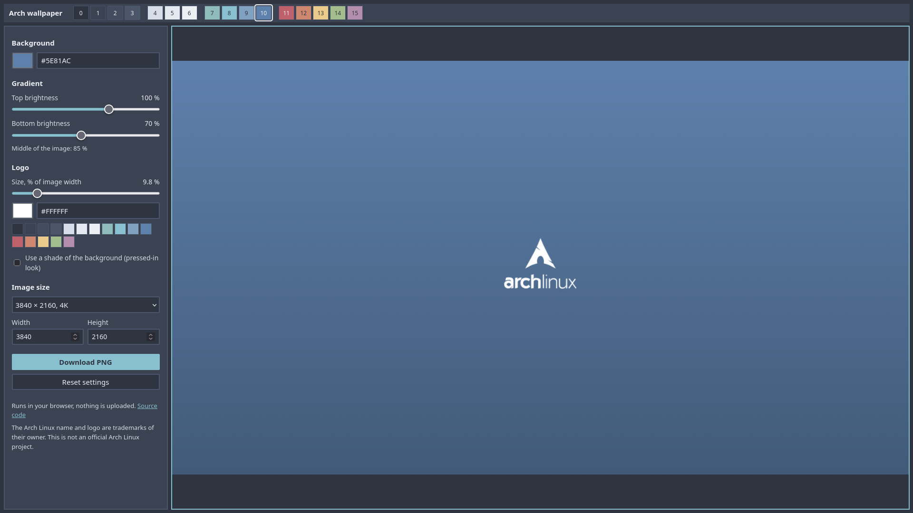

# Arch wallpaper generator

Make your own Arch Linux wallpaper in the browser: pick a colour, shape the gradient, size the logo and download a PNG.

**[Open the generator](https://archlinux-fan.github.io/arch-wallpaper/)**

- See every change live as you drag the sliders.
- Choose colours with a colour picker, a hex code or the 16 [Nord](https://www.nordtheme.com/) colours.
- Set the logo's size and colour, or use a shade of the background for a pressed-in look.
- Make any size up to 7680 pixels, from Full HD to super ultrawide.
- Get a smooth gradient with no visible bands.

Your wallpaper is made on your own computer. Nothing is uploaded.

Prefer a ready-made one? [Browse all 48 wallpapers](https://github.com/archlinux-fan/arch-dots/tree/main/wallpapers), three for each Nord colour.

The code is MIT licensed. The Arch Linux name and logo are trademarks of their owner, and this is not an official Arch Linux project.
